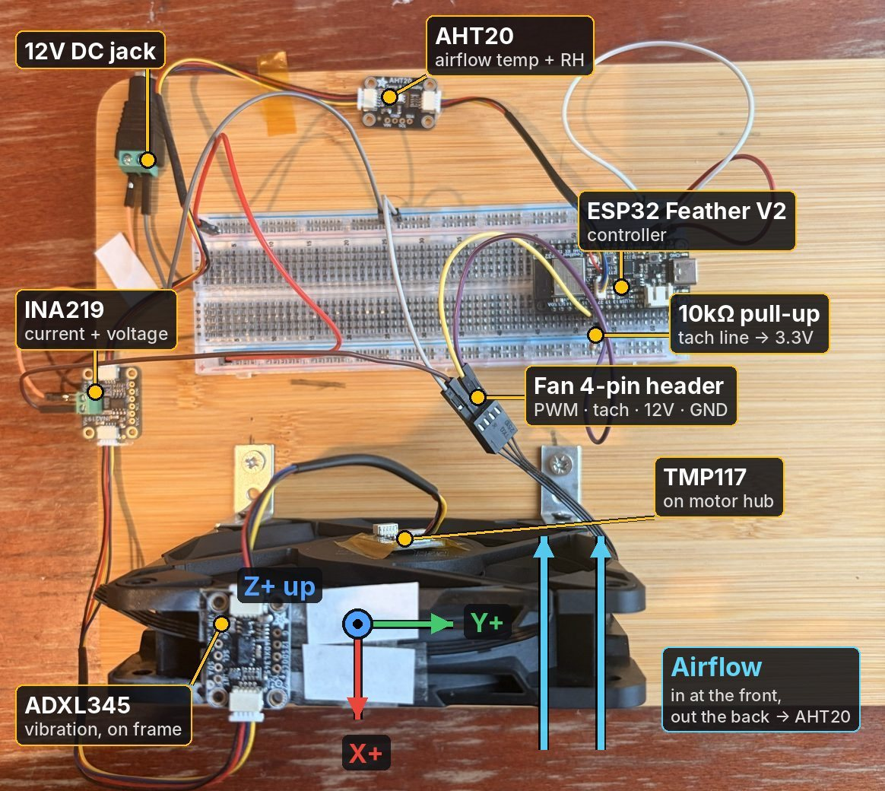
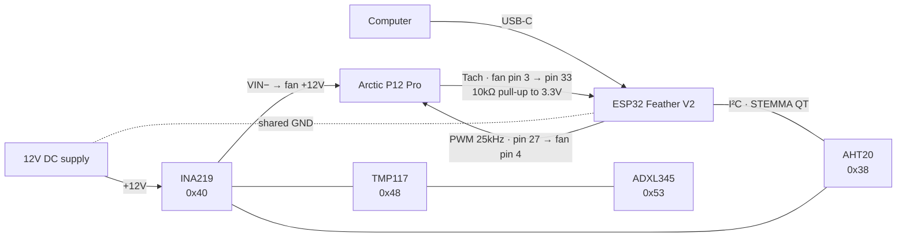
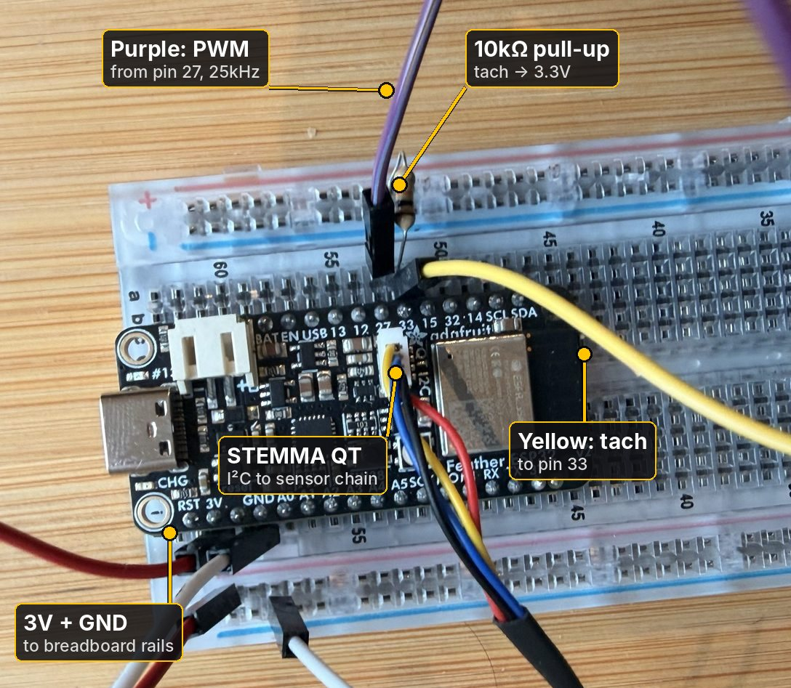
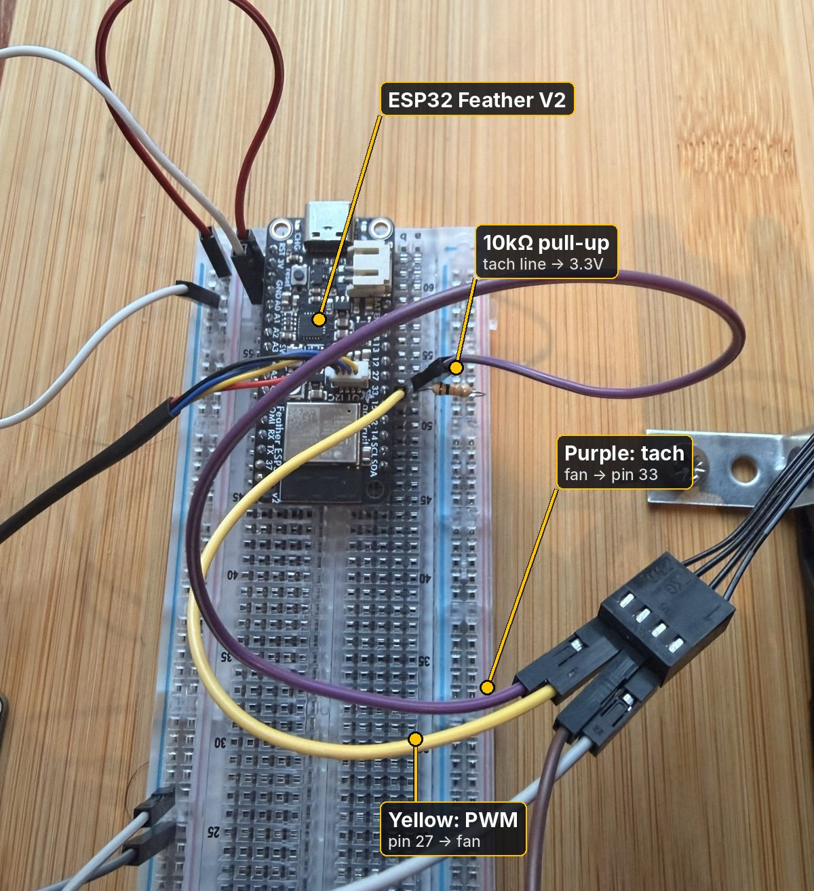
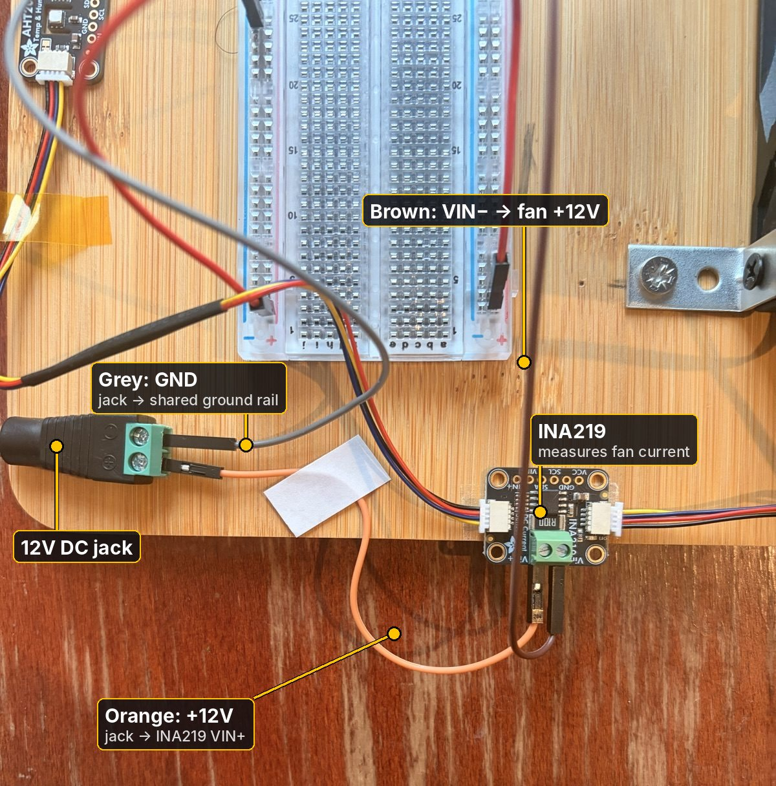
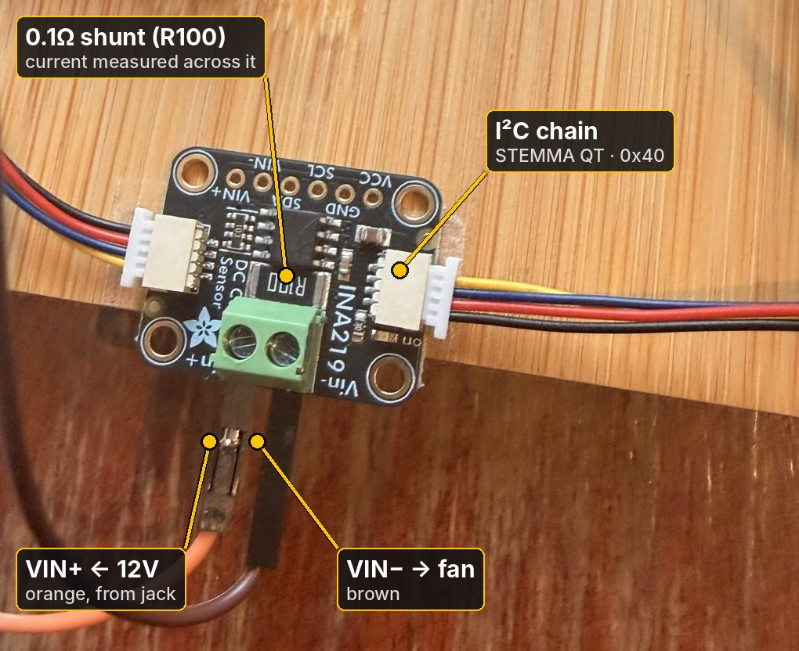
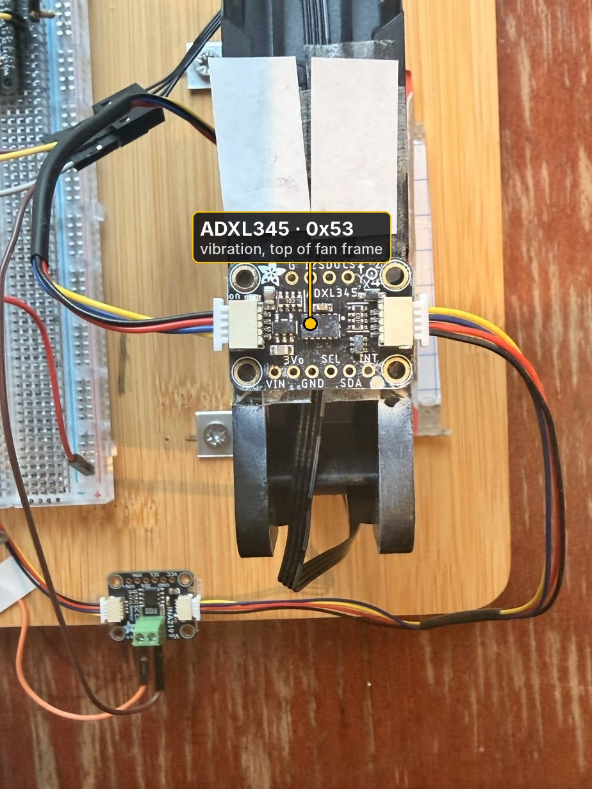
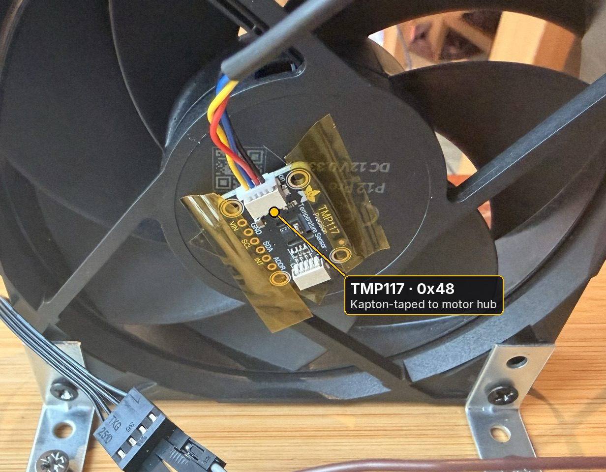
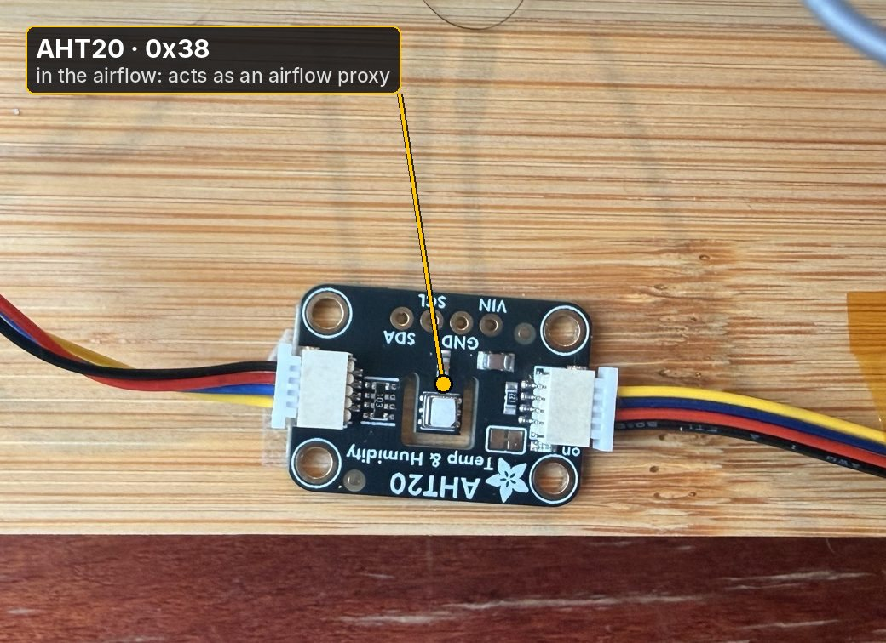
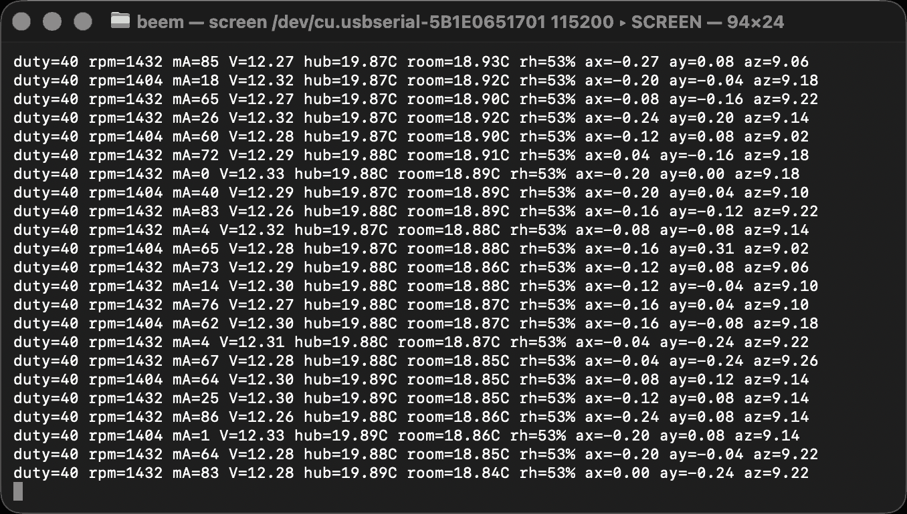

# Phase 0: Hardware

The rig is a 120mm PC fan instrumented with five sensors and controlled by an ESP32. It produces the live data every later phase uses.

## Parts list

| Part | Qty | Purpose | Supplier | Price paid |
|---|---|---|---|---|
| Adafruit ESP32 Feather V2 | 1 | Controller: reads sensors, drives the fan, Wi-Fi | [The Pi Hut](https://thepihut.com/products/adafruit-esp32-feather-v2-with-headers-8mb-flash-2-mb-psram-stemma-qt) | £20.20 |
| Arctic P12 Pro (4-pin PWM, 600–3,000 RPM, 12V 0.33A) | 1 | The fan: the equipment being monitored | [Amazon UK](https://amzn.eu/d/000mpiWH) | £7.99 |
| Adafruit ADXL345 (STEMMA QT) | 1 | Vibration (3-axis accelerometer) | [The Pi Hut](https://thepihut.com/collections/maker-store/products/adafruit-adxl345-triple-axis-accelerometer-2g-4g-8g-16g-w-i2c-spi) | £16.80 |
| Adafruit INA219 (STEMMA QT) | 1 | Fan current and voltage | [The Pi Hut](https://thepihut.com/products/adafruit-ina219-high-side-dc-current-sensor-breakout-26v-3-2a-max) | £9.60 |
| Adafruit TMP117 (STEMMA QT) | 1 | Motor hub temperature (±0.1°C) | [The Pi Hut](https://thepihut.com/products/adafruit-tmp117-0-1-c-high-accuracy-i2c-temperature-sensor) | £11.10 |
| Adafruit AHT20 (STEMMA QT) | 1 | Airflow temperature and humidity | [The Pi Hut](https://thepihut.com/products/adafruit-aht20-temperature-humidity-sensor-breakout-board) | £4.40 |
| STEMMA QT cable, 100mm | 3 | I²C daisy chain | [The Pi Hut](https://thepihut.com/collections/maker-store/products/stemma-qt-qwiic-jst-sh-4-pin-cable-100mm-long) | £1.00 each |
| STEMMA QT cable, 200mm | 2 | I²C daisy chain (longer runs) | [The Pi Hut](https://thepihut.com/collections/maker-store/products/stemma-qt-qwiic-jst-sh-4-pin-cable-200mm-long) | £1.00 each |
| 12V 2A power supply, 5.5×2.1mm barrel | 1 | Fan power | [The Pi Hut](https://thepihut.com/products/12v-2a-power-supply-with-2-1mm-barrel-jack) | £12.50 |
| Female DC jack to screw terminal, 5.5×2.1mm | 1 | Connects the supply to jumper wires | [Amazon UK](https://amzn.eu/d/09xDz482) | £3.99 (pack of 10, M/F) |
| Full-size breadboard | 1 | Wiring | [The Pi Hut](https://thepihut.com/collections/maker-store/products/full-sized-breadboard-transparent) | £5.00 |
| Jumper wires (M–M, M–F, F–F) | 1 set | Wiring (only M–M needed) | [The Pi Hut](https://thepihut.com/products/maker-essentials-mini-breadboards-jumper-jerky) | £11.10 |
| 10kΩ resistors, pack of 25 | 1 | Tach pull-up | [The Pi Hut](https://thepihut.com/products/through-hole-resistors-10k-ohm-5-1-4w-pack-of-25) | £0.80 |
| USB-C to USB-C cable, 1m (data, not charge-only) | 1 | Power and serial to the computer | [The Pi Hut](https://thepihut.com/products/usb-c-to-usb-c-cable-white?variant=42520371069123) | £3.50 |
| L-brackets + screws | 2 | Fan mount | [Amazon UK](https://www.amazon.co.uk/dp/B0CRRDJR8L) | £5.99 (pack of 32) |
| Kapton (heat-resistant) tape | — | Holding the TMP117 on the hub; tidying cables | [Amazon UK](https://www.amazon.co.uk/dp/B0G2LBZPT2) | £3.39 |
| Thermal conductive silicone pads | 1 pack of 6 | Thermal contact between the TMP117 chip and the motor hub | [Amazon UK](https://www.amazon.co.uk/dp/B07X38254H) | £5.55 |
| Double-sided tape | — | Mounting the sensor boards to the base | [Amazon UK](https://www.amazon.co.uk/dp/B004JRM99K) | £3.75 |
| Superglue | — | Rigidly fixing the ADXL345 to the fan frame | Any | — |
| Wooden board (a chopping board 😉) | 1 | Base | [Amazon UK](https://www.amazon.co.uk/dp/B0DRYF9GVZ) | £7.21 |

**Total:** about £142 for parts (including £3.80 Pi Hut shipping), plus tools.

### Tools

| Tool | Used for | Link |
|---|---|---|
| Precision screwdriver set | Screw terminals on the DC jack and INA219 | [Amazon UK](https://www.amazon.co.uk/dp/B0D633J3C7) (£10.99) |
| Drill + screwdriver | Fixing the L-brackets to the base | Any |

## Wiring

### Fan control and speed

| Signal | ESP32 pin | Fan pin | Wire | Notes |
|---|---|---|---|---|
| PWM | 27 | 4 | Purple | 25kHz, 8-bit duty. The fan stops below about 5% duty |
| Tach | 33 | 3 | Yellow | Open-collector: needs a 10kΩ pull-up to 3.3V. 2 pulses per revolution |

### Power path

12V goes from the jack into the INA219's **VIN+**, through its 0.1Ω shunt, out of the **VIN−** into the fan's +12V (fan pin 2). The INA219 measures current from the voltage drop across the shunt. The **ground is shared** between the 12V supply, the fan and the ESP32. Without it, PWM and tach have no common reference.

### Sensor bus (I²C)

All four sensors daisy-chain over STEMMA QT cables from the ESP32's QT port. The firmware must set `NEOPIXEL_I2C_POWER` HIGH to power the port.

| Sensor | Address | Measures |
|---|---|---|
| AHT20 | 0x38 | Airflow temperature, humidity |
| INA219 | 0x40 | Fan current, bus voltage |
| TMP117 | 0x48 | Hub temperature |
| ADXL345 | 0x53 | Vibration (x, y, z) |

## Sensor placement and why

| Sensor | Where | Why |
|---|---|---|
| ADXL345 | Superglued to the top of the fan frame, **off-centre** | Picks up imbalance and rocking where they're strongest. It's glued, not taped: tape let it shift, and any movement changes vibration readings between sessions. It sits off-centre because the fan's 4-pin cable is looped over the top of the frame, and the cable makes a bump under the middle that would stop it sitting flat |
| TMP117 | On the motor hub, chip side down on a small piece of thermal pad, held with Kapton tape | Bearing and motor heat show up here first; the pad gives good thermal contact |
| AHT20 | On the base, **in the fan's airflow** | Acts as an airflow proxy: blocked airflow makes it warm up |
| INA219 | In the 12V line | Current rises with load, friction or a stall |

### ADXL345 orientation

Flat on top of the frame, chip side up.

| Axis | Direction | How it was confirmed |
|---|---|---|
| X | Front–back, along the airflow (the rocking direction). X+ points away from the breadboard | Board silkscreen; check with the tilt test |
| Y | Side to side, along the top of the frame | Board silkscreen; check with the tilt test |
| Z | Vertical, out of the board. Z+ points up | Reads ~+9.1 m/s² at rest: gravity |

The axes are marked on the ADXL345 photo above and on the top-down photo at the start of this doc.

**Tilt test:** with the fan off, run `all_sensors` and tip the whole board so the fan's front dips about 20°. `ax` should change by roughly ±3 m/s² and `ay` should barely move. If it's the other way round, swap X and Y here.

**Airflow direction:** air enters at the front of the fan and leaves through the back (the strut side, where the TMP117 sits), blowing across the breadboard towards the AHT20. In ADXL345 terms, air flows in the X− direction.

**Mounting note:** the fan sits in single-sided L-brackets and can rock slightly front to back. That's accepted: the models learn *this* rig's normal, so the setup is kept the same between recordings. A thin strip of cardboard was also used to cushion the base of the fan as the L-brackets raise it slightly.

## Building it

**Step-by-step instructions are in the [build guide](build.md):** what you need for each step, exact wiring, the code to upload, and what you should see before moving on.

The build goes in nine stages, each checked before the next:

1. ESP32 connected to the computer
2. First sensor (AHT20) reading
3. All four sensors on the I²C chain
4. Fan PWM and tach wiring
5. 12V power path through the INA219
6. Fan speed control working
7. All sensors streaming together
8. Fan and sensors mounted
9. Fault checks

Problems hit along the way, and their fixes, are in the [build log](build-log.md).

## Results

| Duty | RPM |
|---|---|
| 40% | ~1,420 |
| 50% | 1,680 |
| 60% | 2,010 |
| 100% | 3,180 |

**Known measurement quirks**
- **RPM resolution is 30 RPM**: 2 pulses per revolution counted over 1 second, so readings flip between neighbouring values (e.g. 1,404 / 1,432).
- **Single current readings are noisy (0–86 mA)**: the motor draws current in pulses, and the INA219 samples one instant. Phase 1 firmware averages many readings per second.