# Phase 0: Build guide

Step-by-step instructions for building the rig. For the parts list, wiring reference and sensor placement, see [00-hardware.md](00-hardware.md). If something doesn't behave as described, check the [build log](build-log.md): most problems hit during the original build are recorded there with their fixes.

**How to use this guide:** do the steps in order and don't move on until the **Check** passes. Each step adds one thing, so when something breaks you know exactly what caused it.

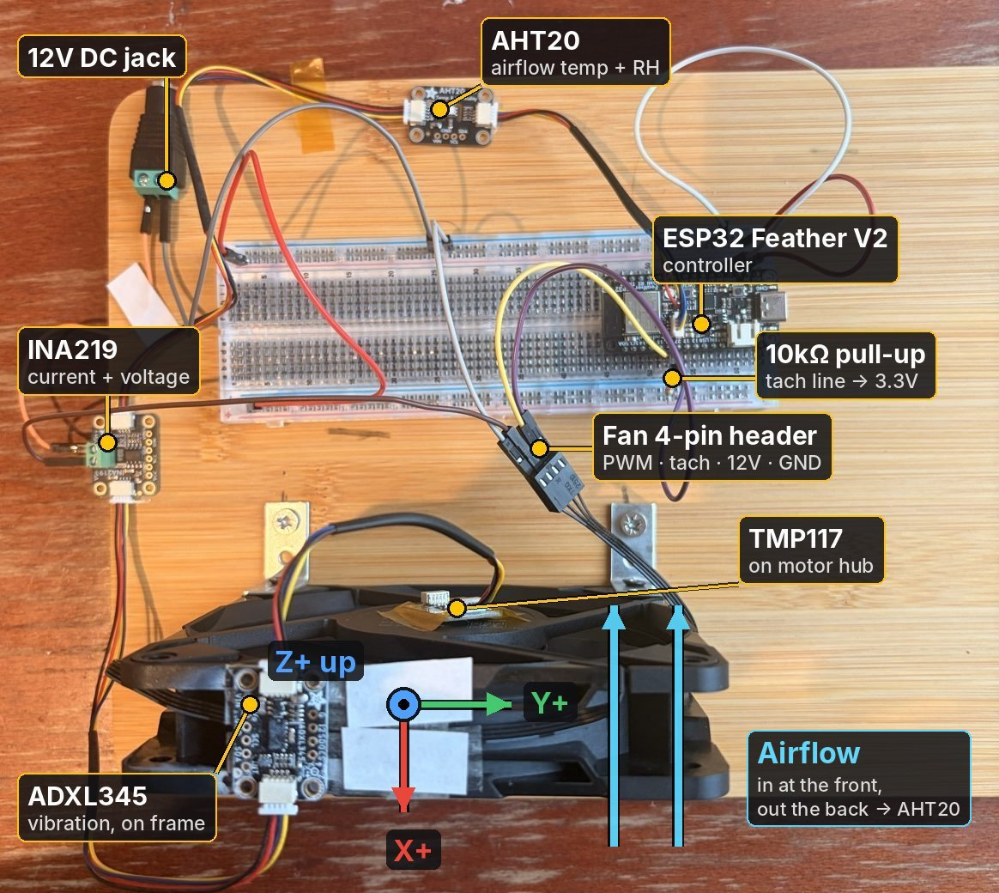

---

## Before you start

**Software**
- [Arduino IDE](https://www.arduino.cc/en/software) (built with 2.3.10)
- A terminal, for reading serial output (macOS Terminal is fine)

**Safety rules for the whole build**
- Connect or move sensors only with **USB UNPLUGGED**
- Change wiring only with the **12V adapter UNPLUGGED**
- **12V must never touch an ESP32 pin.** The only connection between the 12V side and the ESP32 is the shared ground
- Keep fingers, cables and tools clear of fan blades.

**Status light:** every sketch in this guide uses the ESP32's RGB light to show its state, so you can tell what's happening without a screen.

| Light| Meaning|
|---|---|
|Red, briefly| Just started (or restarted)|
|Flashing green / blue | Running, all sensors OK |
|Flashing amber / blue | Running, but a sensor is missing |

**Wire colours:** colour doesn't affect how anything works, but it makes mistakes easier to spot. The usual convention is **red for +12V** and **black for ground**. This rig doesn't follow it exactly because I ran out of some jumper colours:

| Wire | Convention | Used on this rig |
|---|---|---|
| +12V (jack → INA219) | Red | Orange |
| +12V (INA219 → fan) | Red | Brown |
| Ground | Black | White and grey |
| 3.3V (ESP32 → + rails) | Red | Red |
| PWM | Any | Purple |
| Tach | Any | Yellow |

If you're rebuilding the rig, use whatever colours you have. Just be consistent, and trust the step instructions over the photo colours.

---

## Step 1: Get the ESP32 talking to the computer

**You need:** ESP32 Feather V2, breadboard, USB-C data cable

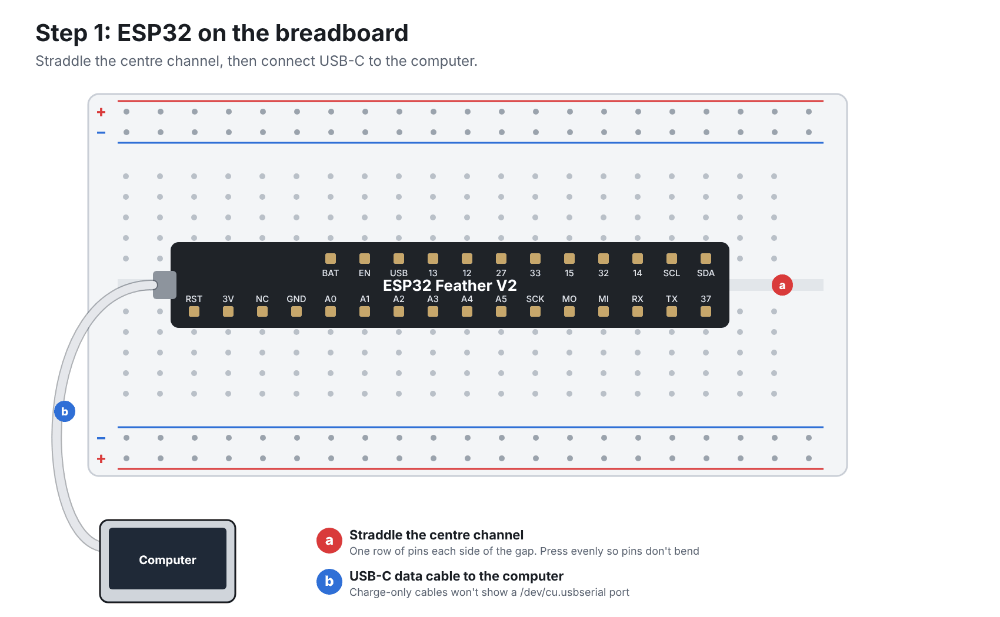

1. Install the Arduino IDE.
2. In **Arduino IDE -> Settings** add this to *Additional boards manager URLs*:
```
https://espressif.github.io/arduino-esp32/package_esp32_index.json
```
3. **Tools -> Board -> Boards Manager**: search 'esp32' and install **esp32 by Espressif Systems**
4. **Tools -> Board -> esp32 -> Adafruit Feather esp32 v2**.
5. **Tools -> Upload speed -> 115200.** The default speed fails to upload on some Macs ("Unable to verify flash chip connection"). <i>I'm using a Macbook Air M3</i>
6. Press the ESP32 into the breadboard so it straddles the centre channel, pressing evenly so the pins don't bend. <i>New breadboards can be stiff: pushing the end of a jumper wire into each hole first loosens them and makes this step much easier.</i>
7. Connect the USB-C cable. **Tools -> Port**: pick one that looks like `/dev/cu.usbserial-...`.
8. Upload [`hello`](../firmware/hello/hello.ino).

A successful upload ends with **"Done uploading."** in the status bar and `Hash of data verified` … `Hard resetting via RTS pin...` in the output. If it fails, see the [build log](build-log.md).

**Check:** read the serial output in Terminal:
```
screen /dev/cu.usbserial-XXXX 115200
```
(replace 'XXXX' with your port; exit with **Ctrl+A, then K, then Y**). You should see `Hello from the fan rig` every second. Always exit before uploading again, or the upload fails with "port busy".

> ⚠ **Use Terminal, not the Arduino Serial Monitor.** On this board and macOS, the Serial Monitor garbles the output every few lines. Also **exit `screen` before every upload**, or the upload fails with "port busy". See the [build log](build-log.md)

> ⚠ **No `usbserial` port?** Check the cable carries data (many USB-C cables are charge only, the listed in [hardware](docs/00-hardware.md) carries data) and that the ESP32 isn't sitting on conductive anti-static foam (it was packaged pinned into some). You shouldn't need to install a driver.

---

## Step 2: First sensor (AHT20)

**You need:** AHT20, 1 x 100mm STEMMA QT cable

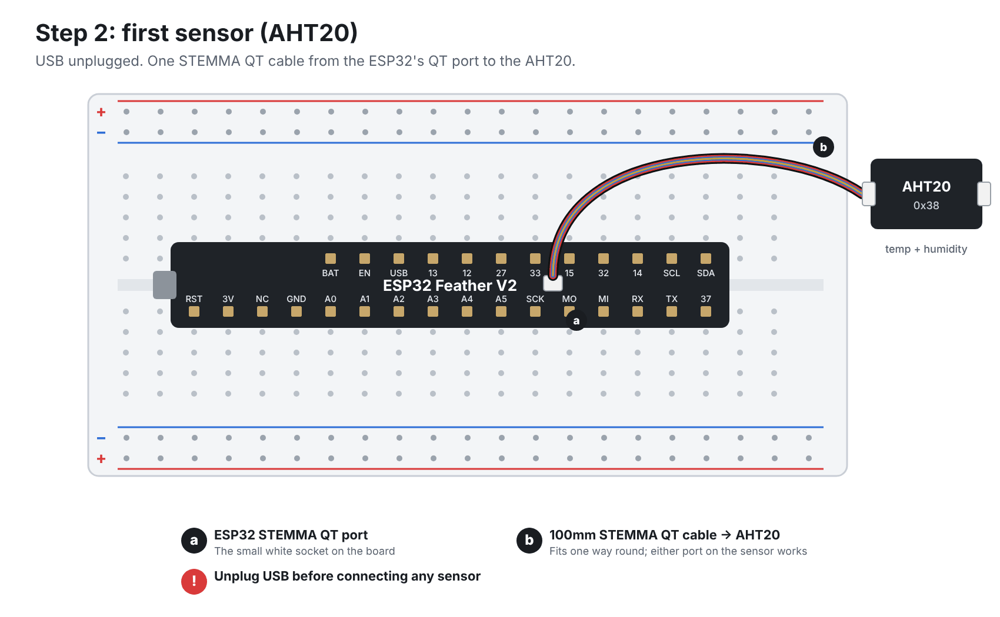

1. **Unplug USB.**
2. Connect the STEMMA QT cable from the ESP32's STEMMA QT port to either port on the AHT20.
3. **Sketch -> Include Library -> Manage Libraries**: install **Adafruit AHTX0** and **Adafruit NeoPixel** (accept "Install all" for all dependencies).
4. Reconnect USB and upload [`aht20_test`](../firmware/aht20_test/aht20_test.ino).

**Check:** in Terminal, you should see a sensible room temperature (around 18–24°C) and humidity, once a second. Breathe gently on the sensor: humidity should jump, then settle. Status light: flashing green/blue.

To read the output, run:
```
screen /dev/cu.usbserial-XXXX 115200
```
Replace `XXXX` with your port. When you've finished checking, exit with **Ctrl+A, then K, then Y**. Always exit before uploading again, or the upload fails with "port busy".

> If it prints `AHT20 not found – retrying…`, unplug USB, reseat the cable at both ends, and reconnect. The sketch keeps retrying, so it recovers by itself once the sensor is connected.

---

## Step 3: Chain the other three sensors

**You need:** INA219, ADXL345, TMP117, 2 × 200mm and 1 × 100mm STEMMA QT cables

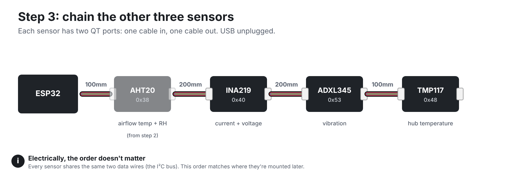

All four sensors share the same two data wires (the I²C bus). Each one has its own fixed **address**, so the ESP32 can talk to them one at a time.

1. **Unplug USB.**
2. Daisy-chain the sensors from the AHT20's spare port: **AHT20 → INA219 (200mm) → ADXL345 (200mm) → TMP117 (100mm)**. Every board has two ports, so electrically the order doesn't matter, but this order matches where they'll be mounted.
3. Leave the sensors loose on the desk for now.
4. Reconnect USB and upload [`i2c_scan`](../firmware/i2c_scan/i2c_scan.ino).

**Check:** open `screen` (see step 2). Every few seconds you should see:
```
Scanning I2C...
  found 0x38
  found 0x40
  found 0x48
  found 0x53
```

| Address | Sensor |
|---|---|
| `0x38` | AHT20 |
| `0x40` | INA219 |
| `0x48` | TMP117 |
| `0x53` | ADXL345 |

The status light goes green/blue only when all four answer. If one is missing, unplug USB and reseat that sensor's cables. If an address appears that isn't in the table, a sensor's address has been changed with a solder jumper on the board.

---

## Step 4: Fan speed (PWM) and RPM (tach) wires

**You need:** the fan, 2 jumper wires, 10kΩ resistor. **No 12V yet.**

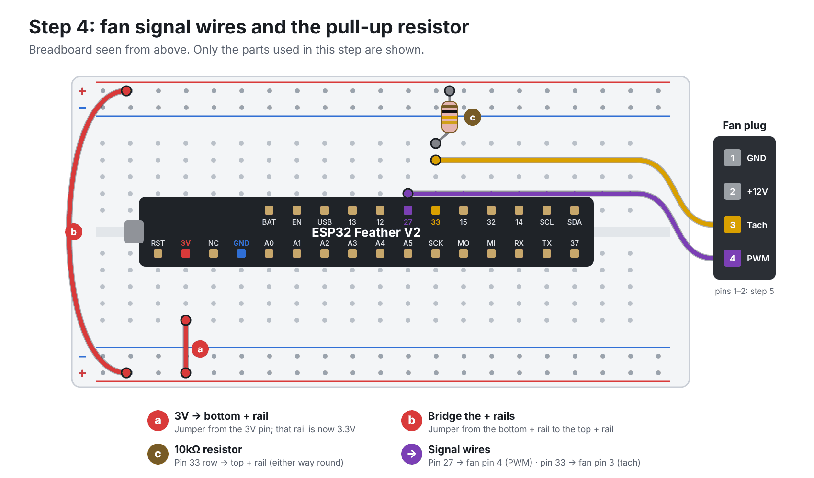

The fan's plug has four wires. Two carry power (step 5); the other two carry information:
- **PWM (speed control):** the ESP32 tells the fan how fast to spin. It does this by switching the wire on and off very quickly (25,000 times a second). The more of the time it's "on", the faster the fan spins. "40% duty" means on 40% of the time.
- **Tach (speed reading):** the fan reports how fast it's actually spinning, by sending two pulses per revolution. The ESP32 counts the pulses to work out RPM.

The fan's 4-pin connector:

| Fan pin | What it carries |
|---|---|
| 1 | Ground (0V) |
| 2 | +12V power |
| 3 | Tach (speed reading, out of the fan) |
| 4 | PWM (speed control, into the fan) |

Pin 1 is usually marked with a small arrow, or sits next to the plastic tab.

1. **Unplug USB.** Stand the fan upright.
2. Fan **pin 4 (PWM)** → jumper (purple in the photos) → ESP32 **pin 27**.
3. Fan **pin 3 (tach)** → jumper (yellow in the photos) → ESP32 **pin 33**.
4. Connect the **10kΩ pull-up resistor** between pin 33 and the ESP32's **3V** pin. On the breadboard this takes three parts:

   **First, the breadboard's power rails.** The long rows along each edge of the breadboard, marked **+** (red line) and **−** (blue line), are called **rails**. Every hole along a rail is connected, so anything plugged into it shares the same connection. The rails on the two sides of the breadboard are **not** connected to each other.

   a. **3V to the + rail:** a jumper wire from the ESP32's **3V** pin to the nearest **+** rail. That whole rail is now at 3.3V.
   b. **Bridge to the other side:** a second jumper wire from that **+** rail to the **+** rail on the opposite side of the breadboard, next to pin 33. Now both + rails are at 3.3V.
   c. **The resistor:** one leg in the pin 33 row, the other leg in that nearby **+** rail.

   Resistors work either way round, so it doesn't matter which leg goes where.

   *Why the resistor is needed:* inside the fan, a tiny switch connects the tach wire to ground twice per revolution, which reads as "low". Between clicks, the switch lets go and the wire isn't connected to anything, so the ESP32 can't read it reliably. The resistor gently holds the wire at 3.3V ("high") whenever the switch lets go. The wire then flips cleanly between high and low, and the ESP32 counts those flips to work out RPM.

5. Check the pin numbers against the labels printed on your ESP32. They're small, so use your phone's camera to zoom in if needed.

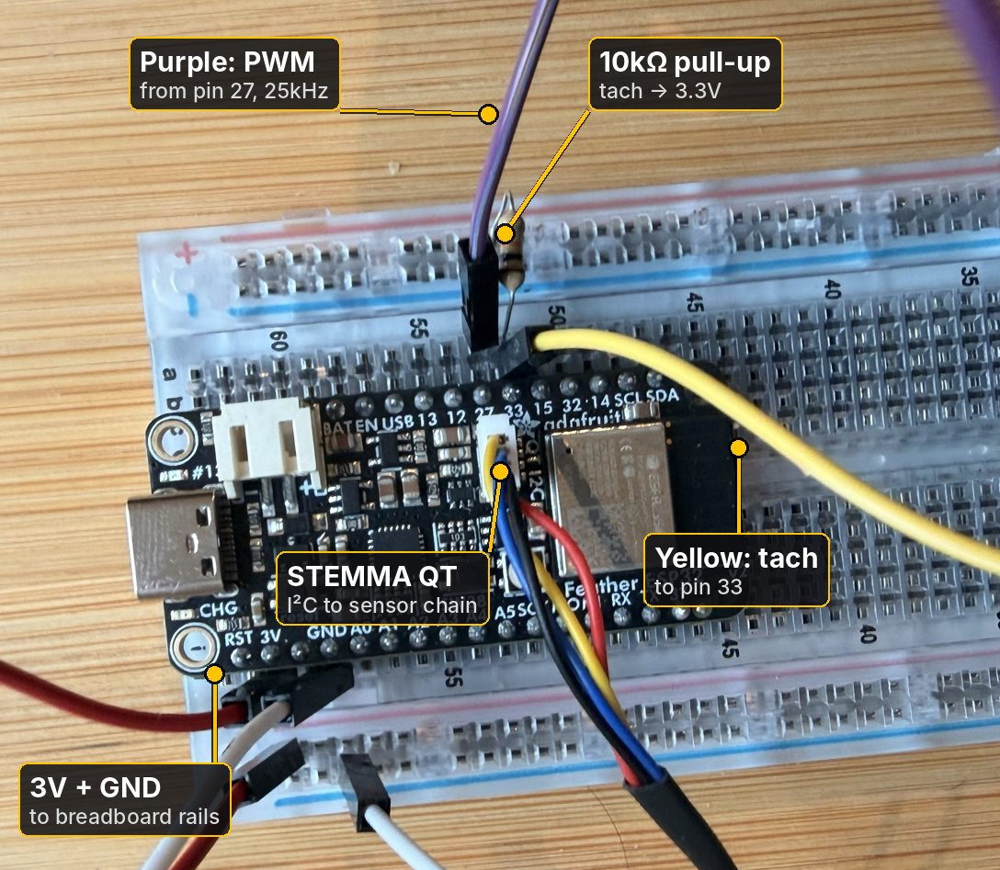

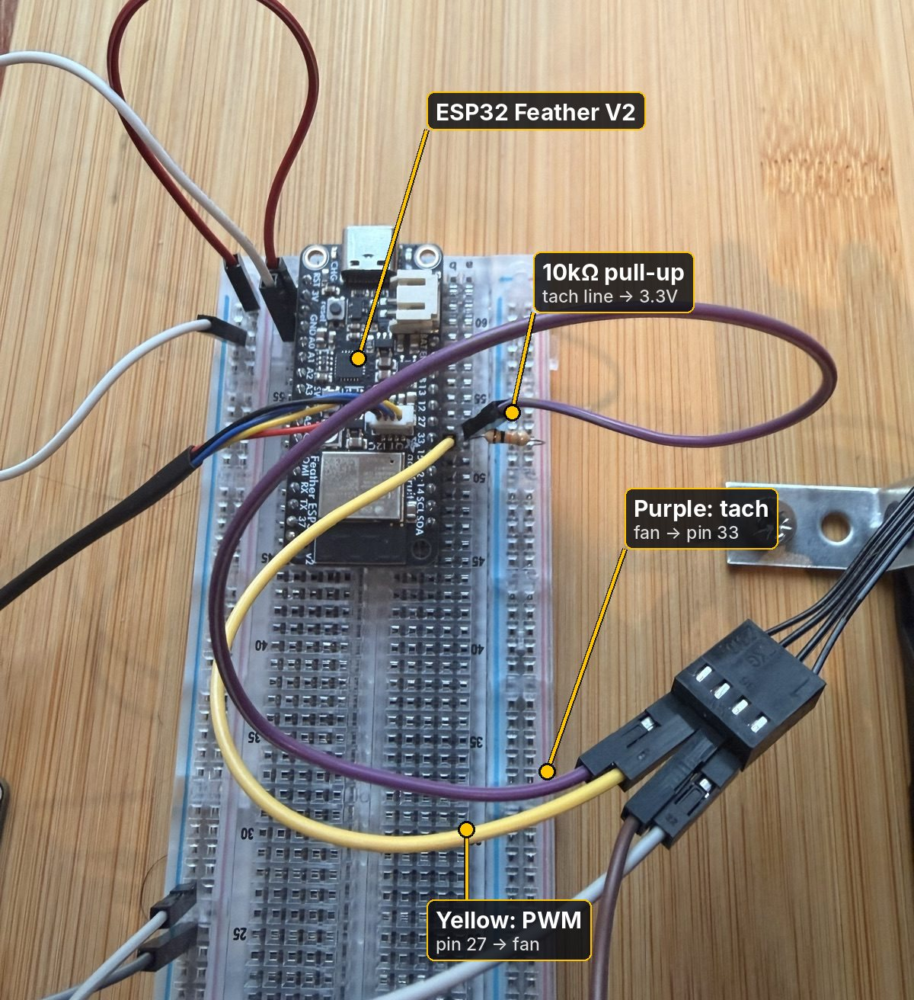

**Check:** wiring only, nothing to run yet. Two wires from the fan connector to pins 27 and 33, plus the resistor from pin 33 to 3V.

> ⚠ Connect the PWM wire **before** the fan ever gets 12V. If a 4-pin fan gets power with no speed signal, it assumes the worst and runs at full speed.

---

## Step 5: 12V power path through the INA219

**You need:** DC jack adapter, 12V power supply, INA219 (already in the chain), jumper wires, precision screwdriver. **Keep the 12V adapter unplugged from the wall throughout.**

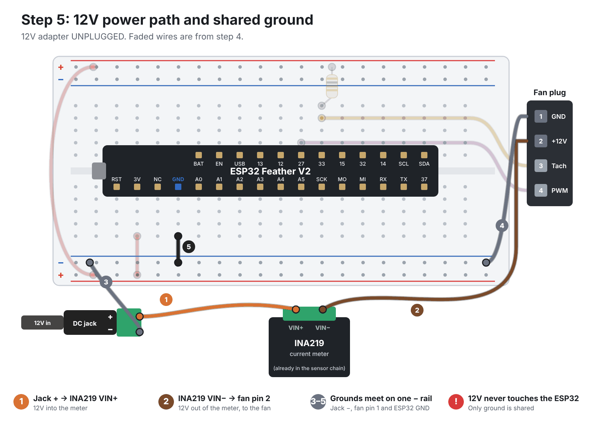

There are two separate power supplies in this rig:
- **USB (from the computer)** powers the ESP32 and the sensors at 3.3V. This is low and safe for them.
- **The 12V adapter** powers only the fan. 12V would destroy the ESP32 if it reached one of its pins.

The two sides are kept apart, except for one thing: **ground**. Ground is the "0V" reference that every voltage is measured from. The ESP32 and the fan must agree on where 0V is, or the speed signals between them don't make sense. So their grounds are connected together, but **12V itself never goes near the ESP32**.

The **INA219** measures how much current (electricity) the fan is drawing. The fan's 12V power passes *through* it on the way to the fan, a bit like a water meter in a pipe.

1. DC jack **+** terminal → jumper → INA219 **VIN+** screw terminal. (12V *into* the meter.)
2. INA219 **VIN−** → jumper → fan **pin 2 (+12V)**. (12V *out of* the meter, to the fan.)
3. DC jack **−** terminal → jumper → breadboard **ground rail** (the long row marked − or blue).
4. Fan **pin 1 (ground)** → jumper → the same ground rail.
5. ESP32 **GND** pin → jumper → the same ground rail.
6. Tighten the screw terminals with the precision screwdriver, then tug each wire gently to check it's held.

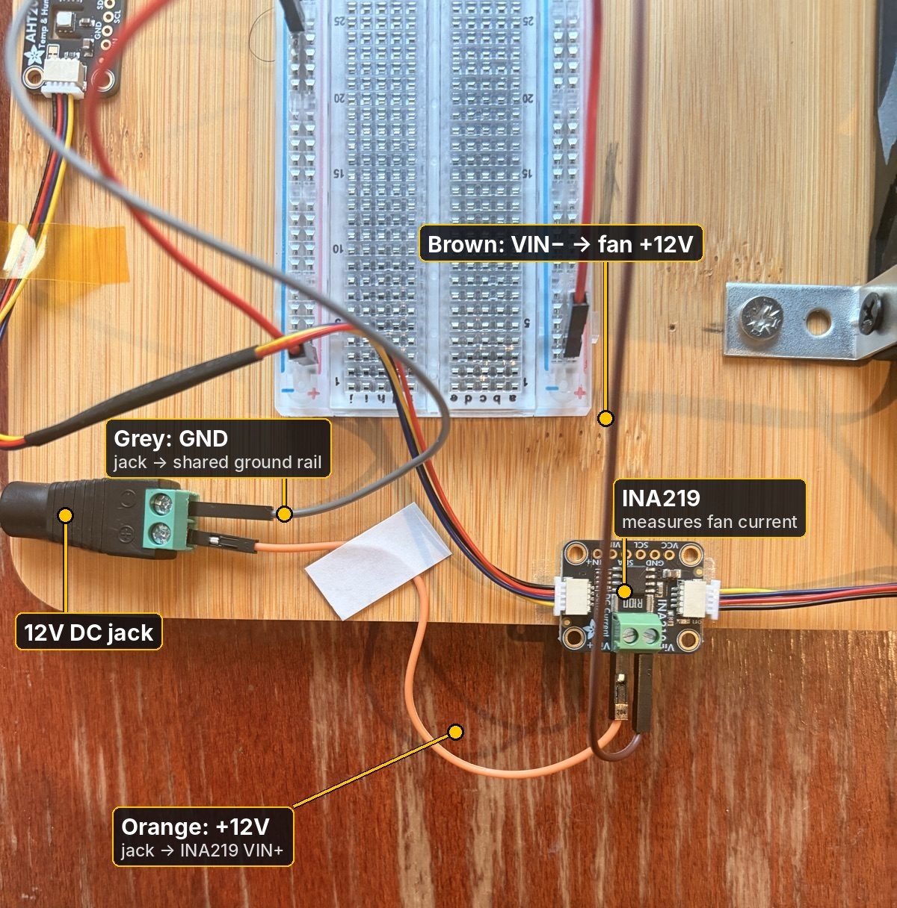

**Check, before plugging anything in:**
- The wire from the jack's **+** goes only to the INA219, and from there only to the fan. Nowhere near the ESP32.
- Three ground wires (jack, fan, ESP32) all meet on the same rail.

> ⚠ **12V must never touch an ESP32 pin.** Only ground is shared.

---

## Step 6: Power on and control the fan

**You need:** everything so far

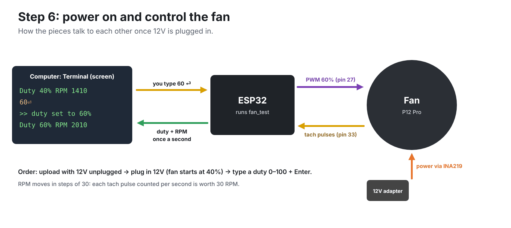

1. With USB connected and **12V still unplugged**, upload [`fan_test`](../firmware/fan_test/fan_test.ino).
2. Plug the 12V adapter into the wall, then into the DC jack. The fan starts at **40%**.
3. Open `screen` (see step 2). Type a number from 0 to 100 and press **Enter** to change speed. The digits appear as you type.

**Check:** once a second you should see:
```
Duty 40%   RPM 1410
```
and after typing `60` + Enter:
```
>> duty set to 60%
Duty 60%   RPM 2010
```

RPM should rise as you raise the duty. On the original rig: 50% → 1,680, 60% → 2,010, 100% → 3,180 RPM. Below about 5% the fan stops completely; that's normal for this model.

RPM moves in steps of 30 (e.g. 1,404 then 1,432). The fan isn't changing speed: the sketch counts whole pulses each second, and each pulse is worth 30 RPM.

> **RPM reads absurdly high (tens or hundreds of thousands)?** The speed-control signal on pin 27 is "leaking" into the neighbouring tach wire, and the ESP32 counts those tiny blips as fan pulses. The `fan_test` sketch fixes this by ignoring any blip shorter than 10 millionths of a second, since real fan pulses are much longer. Make sure you're running the current `fan_test`; see the build log for the full story.

> ⚠ Unplug 12V before changing any wiring. Keep fingers clear of the blades.

---

## Step 7: Read every sensor together

**You need:** libraries **Adafruit INA219**, **Adafruit TMP117** and **Adafruit ADXL345** (install via Library Manager, as in step 2)

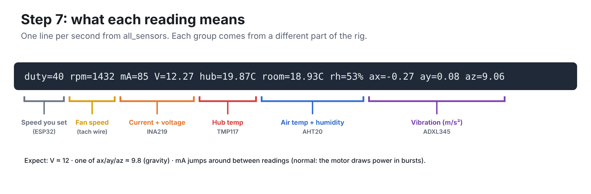

1. Upload [`all_sensors`](../firmware/all_sensors/all_sensors.ino).
2. Open `screen`. You can change speed the same way as in step 6.

**Check:** one line per second, like:
```
duty=40 rpm=1432 mA=85 V=12.27 hub=19.87C room=18.93C rh=53% ax=-0.27 ay=0.08 az=9.06
```

| Reading | What it is | Expect |
|---|---|---|
| `duty` | Speed setting (%) | What you typed |
| `rpm` | Fan speed | Matches step 6 for the same duty |
| `mA` | Current the fan is drawing (milliamps) | Jumps around between readings, e.g. 0–86. That's expected: the motor draws power in quick bursts, and each reading catches a single instant. Later firmware averages many readings |
| `V` | Voltage reaching the fan | About 12 |
| `hub` | Motor hub temperature | Room temperature, creeping up slowly while the fan runs |
| `room` | Air temperature (AHT20) | Room temperature |
| `rh` | Humidity (%) | Typical indoor values, 30–60% |
| `ax`, `ay`, `az` | Acceleration on three axes (m/s²) | One axis reads about 9.8 (that's gravity pulling down); the other two near 0 |

If a sensor isn't found, the sketch prints e.g. `TMP117 missing` and the status light shows amber/blue. Unplug USB and reseat that sensor's cables.

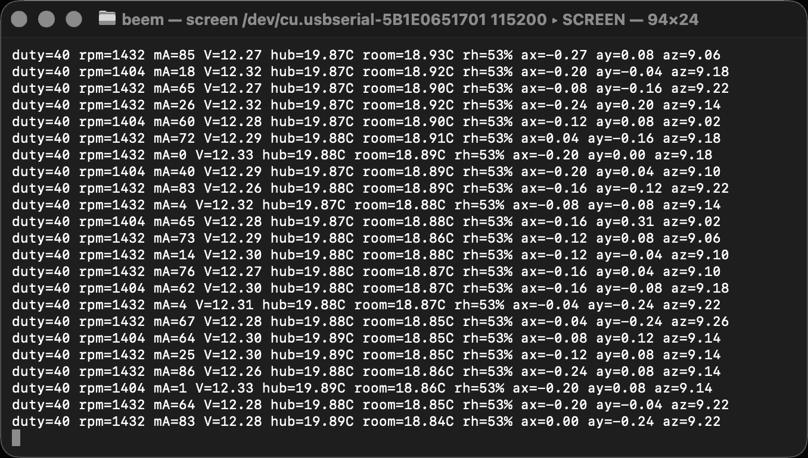

---

## Step 8: Mount everything on the board

**You need:** wooden board, L-brackets and screws, drill + screwdriver, double-sided tape, Kapton tape, a thermal pad, superglue, a thin strip of cardboard

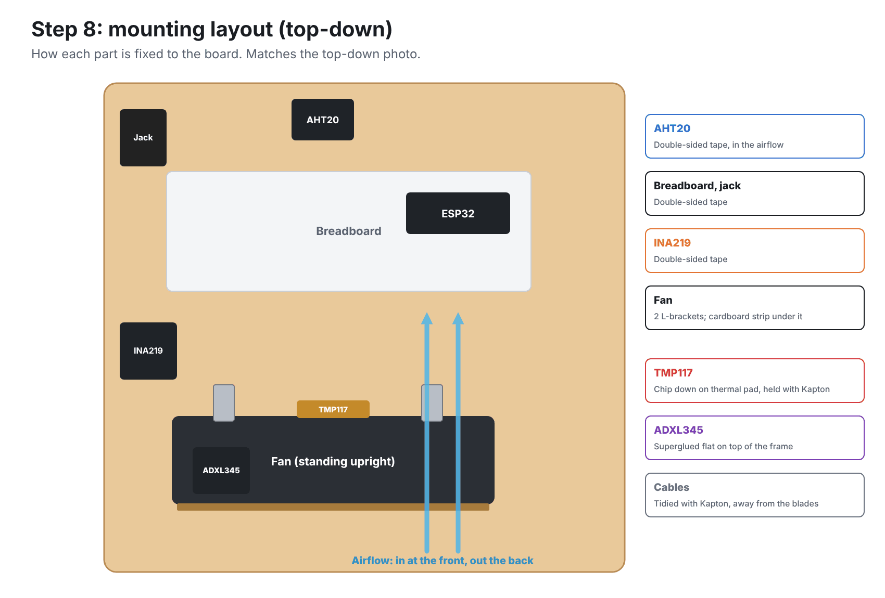

**Only do this once steps 1–7 all work. Unplug 12V and USB first.**

1. **Plan the layout** on the board before fixing anything (see the top-down photo).
2. **Fan:** screw two L-brackets to the board and fix the fan to them, standing upright. Slip a thin strip of cardboard under the fan's base where the brackets lift it.
3. **ADXL345 (vibration):** flat on **top of the fan frame**, chip side up, **superglued**. It must not move at all: if it shifts even slightly, vibration readings change between sessions. Tape wasn't firm enough. Keep glue off the connectors.

   On this rig it's mounted **off-centre**, because the fan's cable loops over the top of the frame and creates a bump in the middle. What matters is that it sits **completely flat** on a solid part of the frame. If your cable is routed differently, the centre is fine too.
   
4. **TMP117 (hub temperature):** on the **motor hub** at the back of the fan, the side with the support struts. The hub is the round centre piece that holds the motor; it doesn't spin. Put a small piece of thermal pad between the sensor's chip and the hub, chip side down, and hold it in place with Kapton tape. The pad helps heat pass from the hub into the sensor.
5. **AHT20 (air temperature):** on the base, **in the fan's airflow** (behind the fan, on the strut side). Moving air cools it slightly, so if the airflow gets blocked, it reads warmer. That makes it useful for spotting blockages.
6. **Breadboard, INA219 and DC jack:** double-sided tape.
7. **Tidy cables** with Kapton tape so nothing can reach the blades.

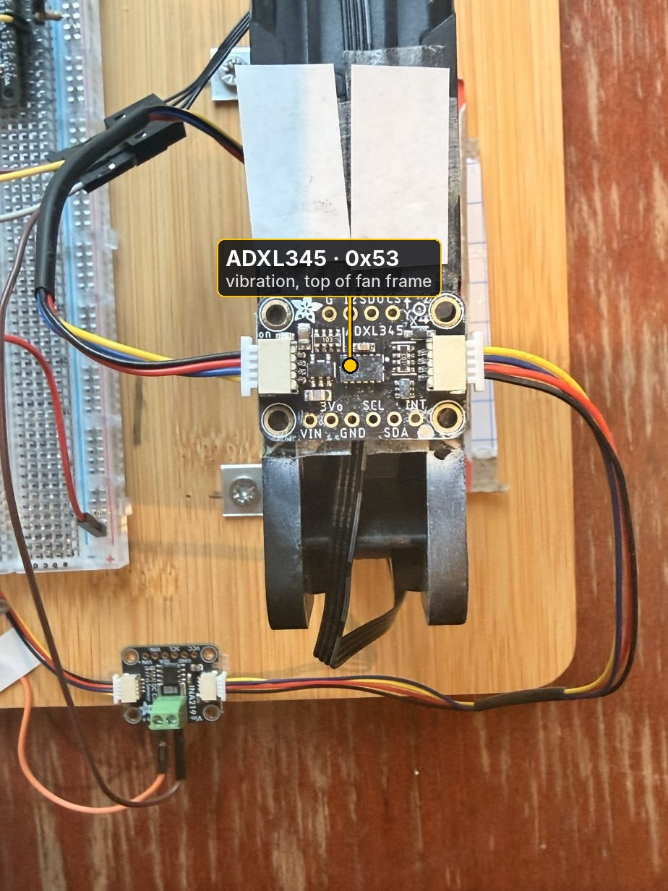

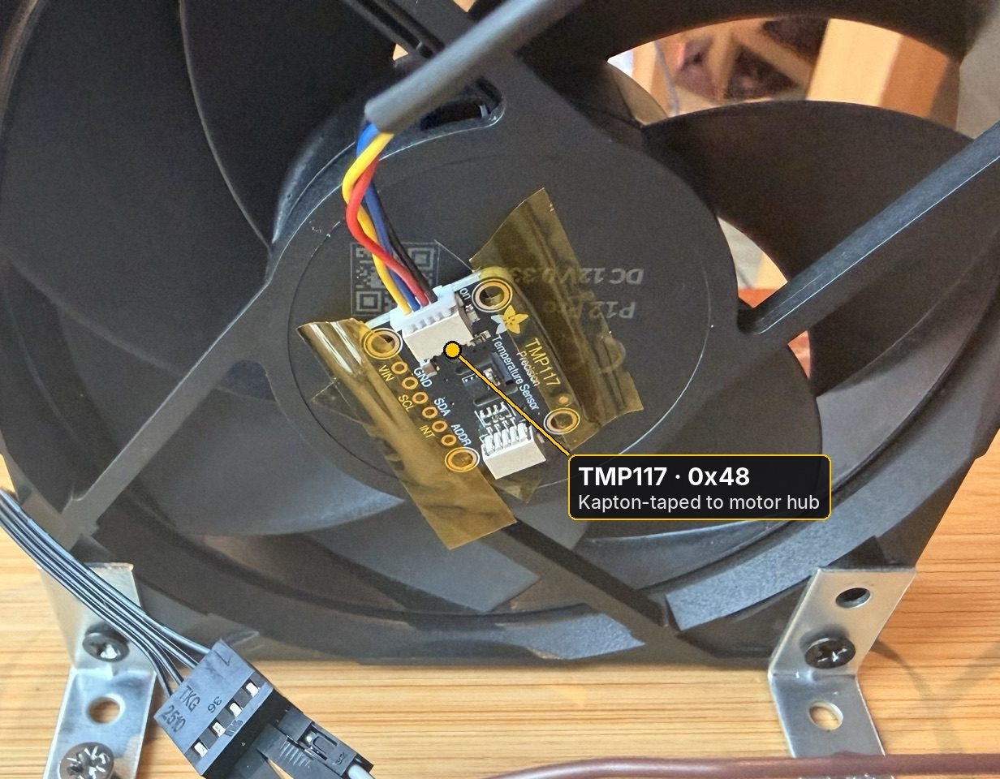

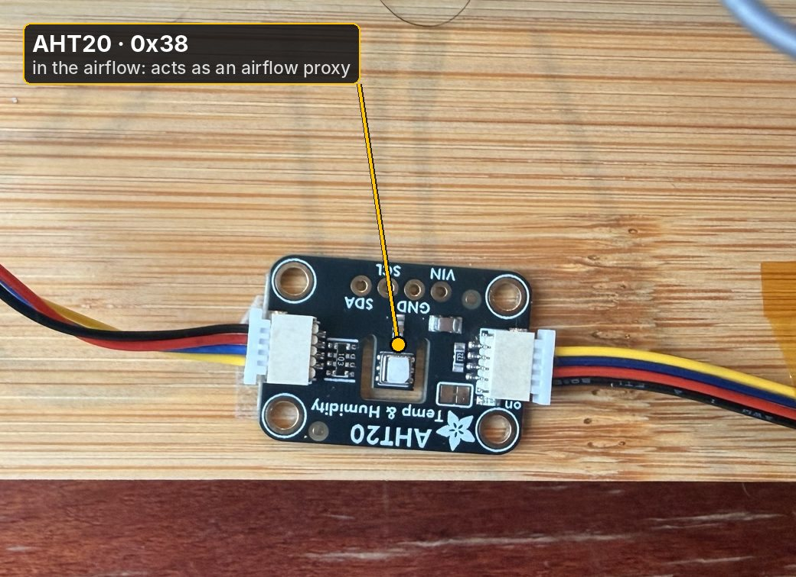

**Check:** re-run `all_sensors`.
- With the fan off, `ax`, `ay` and `az` are steady, and `az` reads about 9.1–9.8 (gravity, which shows the sensor is lying flat).
- With the fan running, they wobble smoothly rather than jumping around wildly.
- Every other reading matches step 7.

---

## Step 9: Sanity checks

Quick tests that each sensor responds to the thing it's meant to measure. Run `all_sensors` with the fan at 40%.

| Do this | What should happen | What it proves |
|---|---|---|
| Unplug the 12V adapter | `V`, `rpm` and `mA` drop to ~0 | Power and current sensing work |
| Plug it back in | Fan restarts; readings return to normal | |
| Tap the fan frame lightly | `ax` / `ay` / `az` jump, then settle | The vibration sensor responds |
| Change duty from 40 to 80 | `rpm` and `mA` rise | Speed control and tach work |
| Leave it running for 10 minutes | `hub` creeps up slowly | The hub sensor has good contact |
| **Tilt test:** fan off, tip the board so the fan's front dips ~20° | `ax` changes by about 3; `ay` barely moves | The vibration axes match [00-hardware.md](00-hardware.md) |

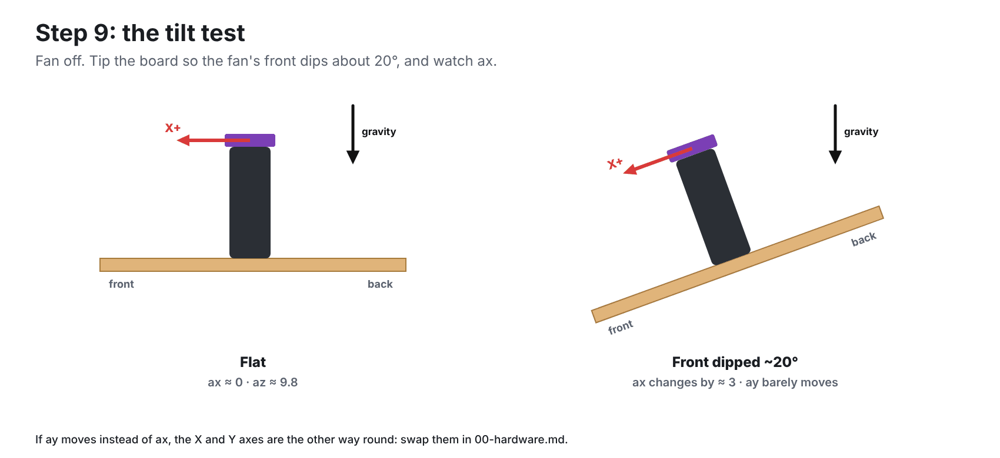

The rig is now ready. Fault experiments (added mass, blocked airflow and more) are recorded in [experiments.md](experiments.md).