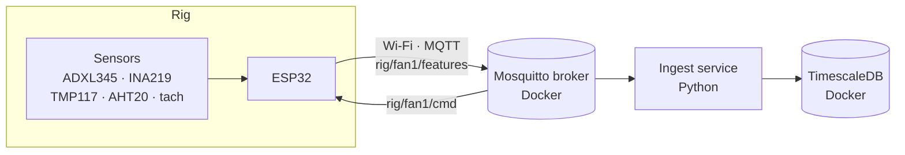
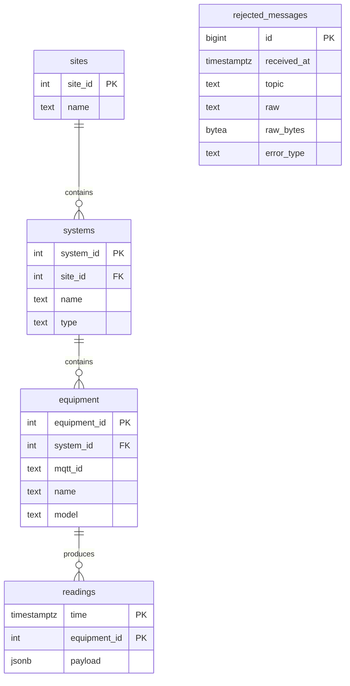

# Phase 1: the data pipeline

How readings get from the fan rig into a database, and why it is built this way.

This document is written during the phase. Each section is completed when its part of the system is finished and stable, and updated if a later decision changes it. Decisions are recorded in more detail in [`decisions.md`](../decisions.md). Problems and their fixes are in [`build-log.md`](../build-log.md).

| Section | Status |
|---|---|
| 1. Overview and architecture | written |
| 2. The rig's messages | written |
| 3. Database schema | written |
| 4. Ingest service | outline (in progress) |
| 5. Results | outline |
| 6. Limitations and next steps | outline |

---

## 1. Overview and architecture

The rig is a PC fan with sensors, controlled by an ESP32. Once a second, the ESP32 sends one message with every reading. The message goes through an MQTT broker to an ingest service, which stores it in TimescaleDB.



**The parts:**

| Part | What it does | Runs on |
|---|---|---|
| ESP32 + sensors | Samples the sensors, summarises each second, publishes one JSON message | The rig |
| Mosquitto | MQTT broker: receives messages and passes them to subscribers | Docker on my Mac |
| Ingest service | Subscribes to every fan's readings, checks each message, stores it | Python on my Mac |
| TimescaleDB | Postgres with time-series extensions. Stores readings and rejected messages | Docker on my Mac |

`docker-compose.yml` starts the broker and the database together with one command.

**Why MQTT between the rig and the database:** MQTT **decouples** them. The ESP32 only needs to know the broker's address. It does not know the database exists. I can add readers later, such as Kafka in phase 2 or a live UI, without changing the firmware.

**Why one message per second with every reading:** all readings from the same second stay together. A model can then compare vibration, current and RPM at the same moment without lining up separate streams.

**Network and security:**
- The broker is open to the home Wi-Fi, because the ESP32 must reach it. It has no password yet; adding one is planned.
- The database port is bound to `127.0.0.1` only, so it cannot be reached from the network.
- Secrets live in ignored files (`.env`, `secrets.h`). The repo contains example files with placeholders (`.env.example`, `secrets_example.h`).

---

## 2. The rig's messages

### Topics

| Topic | Direction | Content |
|---|---|---|
| `rig/fan1/features` | rig → broker | One JSON message per second with all readings |
| `rig/fan1/status` | rig → broker | `online` on connect (retained). `offline` is the **last will**: the broker publishes it if the rig disappears |
| `rig/fan1/cmd` | broker → rig | A number from 0 to 100 sets the fan duty in % |

`fan1` is the rig's MQTT id. The ingest service subscribes to `rig/+/features`, where `+` matches any one topic level, so new fans are picked up without a code change.

**A limit of the last will:** the broker sends it only when it notices the rig is gone, after the keepalive timeout (about 20 s). If the broker itself stops, no last will is sent. The ingest service must also detect silence on its own (see the connectivity status in `decisions.md`).

### Example message

```json
{"uptime_ms":21467772,"duty":0,"rpm":0,"current_ma":6.2,"bus_v":12.32,
 "hub_c":24.71,"airflow_c":23.63,"rh":41.7,
 "ax_rms":0.0807,"ay_rms":0.0810,"az_rms":0.1043,"a_peak":0.3530,
 "vib_samples":323,"power_samples":81}
```

### Fields

| Field | Unit | Sensor | How it is made |
|---|---|---|---|
| `uptime_ms` | ms | ESP32 | Time since the ESP32 started. The ESP32 has no real clock |
| `duty` | % | ESP32 | The fan speed setting (PWM at 25 kHz) |
| `rpm` | rev/min | Fan tach wire | Hardware pulse counter, 2 pulses per turn, scaled to the real elapsed time. A glitch filter ignores spikes shorter than 10 µs |
| `current_ma` | mA | INA219 | Mean of about 100 samples per second |
| `bus_v` | V | INA219 | Mean of the same samples |
| `hub_c` | °C | TMP117 | Temperature at the fan hub |
| `airflow_c` | °C | AHT20 | Air temperature in the airflow. The sensor sits in the airflow on purpose, as an airflow proxy |
| `rh` | % | AHT20 | Relative humidity |
| `ax_rms`, `ay_rms`, `az_rms` | m/s² | ADXL345 | Vibration on each axis: RMS of about 400 samples per second, **with the steady part (gravity) removed first**, so only the shaking is left |
| `a_peak` | m/s² | ADXL345 | Largest swing on any axis in that second, centre to edge (half of max − min) |
| `vib_samples` | count | ADXL345 | How many vibration samples went into this second (target 400) |
| `power_samples` | count | INA219 | How many current samples went into this second (target 100) |

The X axis of the accelerometer is the front–back (airflow) axis.

### Known issues with the messages

These are planned for the firmware session, before real data is recorded:

1. **Lost sampling time.** About 19% of each second is lost: `vib_samples` is about 323 of 400 and `power_samples` about 81 of 100. One known cause is the blocking AHT20 read (about 80 ms). The rest will be measured.
2. **`nan` breaks the message.** If a sensor read fails, the value can be `nan`, which is not valid JSON. The whole message is then rejected, and the good readings are lost with it. Fix: send `null` for a failed read.
3. **Silent truncation.** The message is built in a fixed 400-character buffer. A longer message would be cut off without an error, which gives invalid JSON. Fix: check the length when the message is built.

---

## 3. Database schema

### Tables



(`readings` also has one typed column per reading field. They are left out of the diagram to keep it readable.)

### The hierarchy: sites → systems → equipment

Each reading belongs to a piece of equipment, which belongs to a system, which belongs to a site. Today this is one site (`home-lab`), one system (`rig-1`) and one fan (`fan1`, an Arctic P12 Pro).

**Why a hierarchy for one fan:** it is a small subset of two public building-data standards, **Project Haystack** and **Brick Schema**. The same structure works for a fleet of fans in phase S1, and later for a building (systems → equipment → points). A flat table with a fan name would break as soon as there is more than one site or system.

`equipment.mqtt_id` links a row to its MQTT topic: `rig/<mqtt_id>/features`.

**Integer IDs:** small, fast to join and easy to read while debugging. All records are created in one place, so IDs cannot clash.

### `readings`

One row per fan per second.

- **Typed columns**, one per field in section 2 (`SMALLINT`, `INTEGER`, `BIGINT` or `REAL`). These are fast to filter and average in SQL.
- **`payload` (`JSONB`, `NOT NULL`):** the full message as received and parsed. It is the ground truth: it keeps fields that have no column yet, and it lets me check every column against the original. A NULL payload could only come from a bug in my code, so the database refuses it.
- **`time`:** set by the ingest service when the message arrives, in UTC. The ESP32 has no real clock. UTC never jumps, unlike UK local time.
- **Primary key `(equipment_id, time)`:** one reading per fan per moment, and fast queries for one fan over a time range.

**Hypertable.** `readings` is a TimescaleDB **hypertable**, split into 1-day **chunks**. Each chunk is a hidden table holding one day of data. Queries on recent data only touch recent chunks, so they stay fast as the table grows. I always query `readings`; TimescaleDB sends each query to the right chunks. Later: compression for old chunks, a retention policy, and continuous aggregates (pre-computed averages).

### `rejected_messages`

The **dead-letter table**: every message the ingest service could not store, kept as data.

| Column | Why |
|---|---|
| `id` | Unique number, generated by the database. There is no natural key: two rejects can arrive at the same moment |
| `received_at` | When it arrived (UTC, filled by the database) |
| `topic` | Where it came from |
| `raw` | The message as readable text. Bytes that are not valid text are written as escapes, e.g. `\xff` |
| `raw_bytes` | The **exact** bytes received (`BYTEA`). The text version alone cannot tell the single byte `0xff` from the four characters `\xff` |
| `error_type` | The kind of failure, e.g. `JSONDecodeError`, so rejects can be counted by type |
| `error_message` | The detail, for a human |

**Why keep rejects as data, not only log lines:** a reject is a signal. A run of rejects can mean a failed sensor, a truncated message, a bug in the fleet simulator or a firmware change. In a table, I can count them, chart them and show them in the event feed. It is a plain table, not a hypertable, because rejects should be rare.

### How the schema is applied

The schema SQL file runs automatically the first time the database starts with an empty volume. It also creates the rig's site, system and equipment rows. Changes to an existing database must be run by hand as well, and the file updated to match, so a fresh rebuild gives the same result. Proper **migrations** (numbered change files that run in order) are planned for when the stack moves to Kubernetes.

---

## 4. Ingest service (outline: in progress)

To write when the reconnect and logging are finished.

- How it runs: load settings from `.env`, connect to the database, connect to the broker, subscribe in `on_connect` (so the subscription is renewed after every reconnect), then wait for messages.
- From message to row: topic → `mqtt_id` → `equipment_id` (cached; unknown ids are not cached) → values in column order → one INSERT.
- The mapping dict (payload key → column) and `build_insert()`: why the INSERT is built from column lists, and why placeholders keep values out of the SQL text.
- **Validate at the boundary:** valid bytes and JSON → a JSON object → known equipment → values the database accepts. Each failure goes to `rejected_messages` through one `reject()` helper.
- Which errors are caught and which stay loud (`DataError` = bad message; `ProgrammingError` = my bug; `OperationalError` = database problem).
- `scripts/send_bad_messages.sh`: one example of each reject.
- Database outages: drop and count, reconnect at most every 5 s, never block. Why blocking would give wrong timestamps.
- Logging: levels and timestamps.
- How to run it and what normal output looks like.

## 5. Results (outline)

To write after the SQL queries step.

- What a normal second looks like at 0%, 40%, 60% and 100% duty (table from the first data).
- First findings: the vibration noise floor, the 6 mA standby current, the tach reading 0 before the blades stop, speed-change overshoot, the probable resonance band, airflow cooling of the hub.
- Queries: latest reading per fan, per-minute averages with `time_bucket`, finding gaps, rejects by type, the column-vs-payload check.
- Evidence that the pipeline works: rows per second, gaps found, rejects found.

## 6. Limitations and next steps (outline)

To write at the end of the phase.

- One fan; test data only so far.
- The sampling loss and the `nan` issue, until the firmware session.
- Ingest time, not device time; lost messages during a database outage are counted, not recovered.
- No broker password yet.
- Schema changes by hand until migrations.
- Next: Kafka (phase 2), so every model reads the same live stream.

---

## Milestones

| Date | Milestone |
|---|---|
| 6 Nov 2026 | Docker installed; Mosquitto broker running |
| 6 Nov 2026 | MQTT tested in the container, from the Mac and over Wi-Fi |
| 6 Nov 2026 | ESP32 publishing all readings once a second; duty commands over MQTT |
| 9 Nov 2026 | Docker Compose: broker and TimescaleDB together; schema created |
| 9 Nov 2026 | Ingest service storing rows; then all 14 readings plus the raw payload |
| 11 Nov 2026 | Ingest service survives bad messages |
| 12 Nov 2026 | Dead-letter table with exact raw bytes; `payload NOT NULL` |
| 12 Nov 2026 | Database outage behaviour designed (drop and count) |